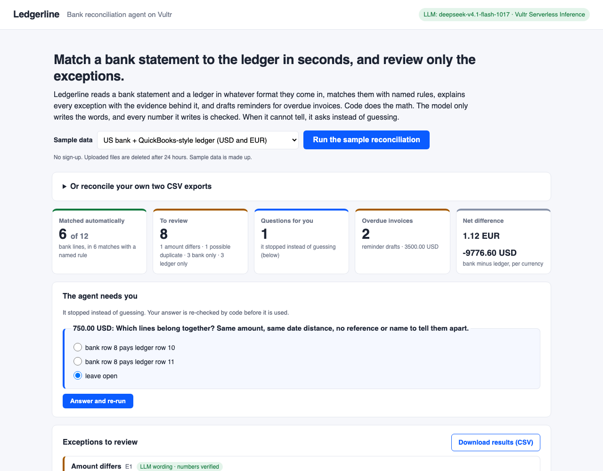
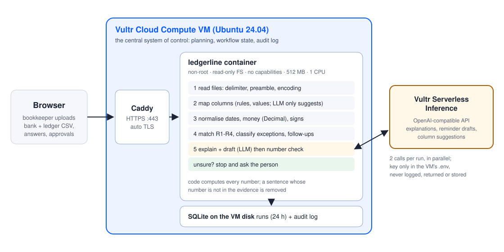

# Ledgerline: a bank reconciliation agent that does not guess

**Vultr Agent Rush Hackathon, Challenge 02 "Powering the Future of Work": Finance & Accounting.**

**Live demo:** <https://64-176-236-185.sslip.io> (on a Vultr VM in Seoul; [`/?demo=1`](https://64-176-236-185.sslip.io/?demo=1) runs the sample on load) ·
**Video:** _link_ · **Slides:** [`docs/slides.pdf`](docs/slides.pdf)

**The problem.** Every month someone in finance puts the bank statement next to the ledger and ticks off lines
one by one. Exports never look the same (`1.234,56` or `1,234.56`, day-first or month-first, Debit/Credit or one
signed column), and the hard cases are the exceptions: a wire fee taken off a payment, one transfer paying two
invoices, a double charge. A chat assistant can do this arithmetic, but it can also make up a number.

**Who it is for.** Small finance teams that close the month in spreadsheets, and bookkeeping firms that do it
for many clients with many bank formats.

**What it does.** Upload two CSV exports. Ledgerline matches them with named rules, explains each exception
with the evidence behind it, drafts reminders for overdue invoices, and stops to ask when two answers are
equally likely. A person approves each reminder, and the approval goes to an audit log.

**Why it runs on Vultr.** The whole agent runs on one **Vultr Cloud Compute** VM: reading files, planning the
steps, matching, the question-and-answer loop, run state and the approval audit log (SQLite on the VM disk).
The wording comes from **Vultr Serverless Inference** (OpenAI-compatible). There is no other cloud service, and
with `LLM_DISABLED=1` no data leaves the VM. [Architecture below](#vultr-infrastructure).



<sub>Screenshot of the live Vultr deployment, with the wording written by Vultr Serverless Inference.</sub>

**Try it in 30 seconds:** open the demo URL, pick one of three sample sets (US bank + QuickBooks-style ledger,
German `;` export with `1.234,56` amounts + Xero-style invoices, UK bank with Paid in / Paid out + Sage-style
ledger) and click **Run the sample reconciliation**. The summary cards show how many bank lines matched by a
named rule, how many exceptions are left, what the agent stopped to ask, the overdue invoices and the net
difference per currency. Answer the question and it re-runs with your answer. **Download results (CSV)** gives
the same in a spreadsheet.

Three rules run through the design:

1. **Code does the math.** Matching, differences, totals, days overdue: all deterministic Python on
   `Decimal`, with each result tagged by the rule that produced it.
2. **The model writes the words, and every number it writes is checked.** Any sentence with a number
   that is not in the evidence card is removed and the removal is shown. A follow-up email with an
   invented number (a late fee, a total) is rejected and replaced by a template, with the reason.
3. **When it cannot tell, it asks.** It does not guess on two equally plausible matches, unclear columns,
   or dates that could be day-first or month-first. It stops and asks the user, then re-runs with the answer.
   The answer is checked too: a column picked as "amount" that holds dates is not used, and the question
   comes back with the reason.

---

## What it does (one run)

```
upload bank.csv + ledger.csv
  → read: delimiter, preamble lines, encoding; unreadable files are an error, never an empty "all clear"
  → understand columns: header rules (EN/DE/FR/ES), then value checks (dates? amounts? running balance?)
       still unclear → the LLM suggests a mapping, code checks it parses, the user confirms
  → normalise: dates (day/month decided by the data or by row order, else asked), money as Decimal,
       debit/credit, money-in/out or DR/CR columns, per-row currency
  → choose the ledger sign convention that agrees with the bank (exports disagree)
  → match: R1 reference + amount · R2 amount + date window · R3 split payments (2–3 lines sum exactly)
       · R4 same payee/reference but different amount → exception with the computed difference
  → classify: amount mismatch, possible duplicate, unmatched bank/ledger, unreadable row
  → explain + draft (two LLM calls in parallel) → number check → template fallback if needed
  → overdue receivables → reminder drafts → human approval → audit log
```

The UI opens with summary cards (counted on the server), then the questions, each exception with an
**evidence card** (rule, computed facts, source rows), the reminder drafts, totals per currency (never summed
across currencies) and every step with its duration and decision. Results export as CSV, with formula-like
text cells defused so the file is safe to open in Excel.

## How this maps to the judging criteria

| Criterion | Where it is met |
|---|---|
| **Application of Technology** | The LLM is used where language matters and kept away from arithmetic: column understanding (`app/llm_columns.py`, suggestion validated by code then confirmed by the user), exception explanations and reminder drafts (`app/narrate.py`), both guarded by a number checker (`app/numcheck.py`). It runs on **Vultr Serverless Inference** (OpenAI-compatible) by default; one env var swaps the endpoint. The two LLM calls run in parallel, so a run takes 1.5–3.1 s end to end on the live VM (median 2.2 s over the 20 cases). |
| **Presentation** | `docs/slides.pdf` (problem, solution, demo, architecture, evaluation, market, roadmap) and `docs/demo_script.md` (2–3 min video). The UI shows the agent's steps and timings live. |
| **Business Value** | Month-end close in small finance teams and bookkeeping firms: the matching is tedious and errors are expensive. Ledgerline handles the exports people already have (QuickBooks, Xero, Sage-style, US/EU/UK/AU/CA bank CSVs, `;` and tab separators, `1.234,56` amounts, DR/CR columns, preamble lines) and leaves a reviewer with only the exceptions, each with evidence and a next step. |
| **Originality** | An agent that is designed to *stop*: ties, unclear columns and undecidable date formats become questions, not guesses. LLM output is verified against code-computed evidence and every removal is visible. Exceptions carry evidence cards a human can audit. Unreadable rows and LLM failures are shown, never turned into empty results. |

## Vultr infrastructure

| Vultr service | Role |
|---|---|
| **Vultr Cloud Compute** (one VM, Ubuntu 24.04) | Runs the whole backend: the agent pipeline, HTTP API and UI in one Docker container, behind Caddy for HTTPS. It is where planning, matching, follow-up workflow state and the audit log live. |
| **VM disk** (Docker volume `/data`) | SQLite run history + audit log of approvals (`app/store.py`). |
| **Vultr Serverless Inference** | LLM for column suggestions, explanations and reminder drafts, via `https://api.vultrinference.com/v1/chat/completions`. |



The container runs as a non-root user with a read-only filesystem, all capabilities dropped and memory/CPU
limits (`deploy/docker-compose.yml`). The API key is only read from the environment. It is never logged,
returned by `/healthz` or stored (`tests/test_api.py` checks this). Runs are stored under unguessable IDs,
there is no listing endpoint, and runs are deleted after 24 hours, because they contain uploaded financial
rows. Each client is limited to 20 runs per 10 minutes to protect inference credits. The UI has no inline
script, so the server sends a strict Content-Security-Policy, and run responses are marked `no-store`.
Each reminder draft can be approved once; a second approval is refused (409) so the audit log has one decision per draft. The client address
comes from the TCP peer, or from Caddy, which is the only proxy trusted to set it.

## Run it

Local (Python 3.12):

```bash
pip install -r requirements-dev.txt
cp .env.example .env            # set LLM_API_KEY and LLM_MODEL, or LLM_DISABLED=1 for code-only text
set -a; . ./.env; set +a
uvicorn app.main:app --port 8080   # open http://127.0.0.1:8080 and click "Run the sample reconciliation"
pytest -q
```

Docker (the same image that runs on Vultr):

```bash
docker build -t ledgerline .
docker run -p 8080:8080 --env-file .env --read-only --tmpfs /tmp -v ledgerline-data:/data ledgerline
```

Deploy on a Vultr VM (Ubuntu 24.04; the 1 GB plan is enough, but pick one **with an IPv4 address**, since the
HTTPS name `<ip>.sslip.io` needs it):

```bash
# on the VM, as root. Public repo:
curl -fsSL https://raw.githubusercontent.com/<you>/<repo>/main/deploy/vultr-setup.sh | bash -s -- https://github.com/<you>/<repo>.git
# Private repo: copy the folder from your machine instead (the local .env stays behind), then run it on the VM:
#   rsync -a --exclude .env --exclude .git ./ root@<ip>:/opt/ledgerline/ && ssh root@<ip> bash /opt/ledgerline/deploy/vultr-setup.sh

# The first run installs Docker, opens ports 22/80/443, creates /opt/ledgerline/.env (mode 600) and stops.
nano /opt/ledgerline/.env                      # LLM_API_KEY = Vultr Serverless Inference key
/opt/ledgerline/deploy/list-vultr-models.sh    # pick a model id, put it in LLM_MODEL
bash /opt/ledgerline/deploy/vultr-setup.sh     # builds, starts Caddy + app, waits for https://<ip-with-dashes>.sslip.io/healthz
```

## Evaluation

Twenty cases written blind by a separate agent that never saw the code: QuickBooks/Xero/Sage-style ledgers,
German `;`/`1.234,56` exports, Spanish and French headers, tab-separated files, preamble lines,
DR/CR columns, split payments, bank-fee shortfalls, duplicates, real identical payments, ties,
undecidable dates, meaningless headers and unreadable rows.

- First sight: **8/10** and **8/10** exact. Every failure and its fix is listed in [`eval/RESULTS.md`](eval/RESULTS.md).
- Now: 20/20 exact, also through the public URL on the Vultr VM with Vultr Serverless Inference
  (`deepseek-v4.1-flash-1017`) writing the text. A run takes a median of 2.2 s, and at most 3.1 s.
- An independent code review found 15 more defects (sign parsing, thousands separators, a spoofable rate
  limit, crash paths and others). All are fixed and each has a regression test.
- After the review, three sample sets were added; the UK one exposed a gap: a customer who paid on the due
  date, a month after the invoice, without a reference, stayed unmatched and got a reminder draft. Days are
  now counted from the due date when that is nearer, and the evidence card says so. All 20 cases still pass.
- 72 tests (`pytest -q`), including LLM-invented numbers being removed and the LLM being down (the app falls
  back to template text and says so).

## Limits (honest)

- CSV only (no PDF statements, no bank API). One bank account per run.
- Matching tolerances are fixed: 7-day window (from the invoice date or the due date, whichever is nearer), or 45 days when the invoice number appears on the bank line.
  A fee rule applies for differences within 2% or 50 units, and needs payee evidence.
- Reminder approval records the decision in the audit log. Sending email is not wired up in this demo.
- The number checker ties money next to a currency to the evidence's money fields, and allows a percentage
  only if the evidence states it. Other numbers only have to appear somewhere in the evidence, so a real day
  count used in the wrong place can still pass. Numbers written as words are not checked; reminder drafts
  that mention fees, interest or penalties are rejected outright.
- What the model sees: the rows of each exception (dates, amounts, names, references, descriptions) and the
  overdue invoices, plus the headers and first 6 rows of a file whose columns are unclear. Whole files are not sent. With
  `LLM_DISABLED=1` nothing leaves the VM. A description in an uploaded file could try to steer the reminder
  wording; numbers and fee words are checked and a person approves each draft, but links are not filtered.
- Files are limited to 1,500 rows each. Uploaded rows are deleted after 24 hours (`RETENTION_HOURS`).

## Repository layout

```
app/            pipeline.py (workflow + trace) · table.py · columns.py · values.py · reader.py
                matcher.py (R1–R4) · reconcile.py (duplicates, exceptions, totals, follow-ups)
                llm.py (OpenAI-compatible client) · llm_columns.py · narrate.py · numcheck.py
                store.py (SQLite) · export.py (CSV) · main.py (FastAPI) · static/ (UI, no build step)
samples/        three demo sets: us_quickbooks/ · de_bank_semicolon/ · uk_bank_paid_in_out/ (made-up data)
eval/           blind cases (cases/, holdout/), run_eval.py, RESULTS.md
tests/          pytest
deploy/         docker-compose.yml (app + Caddy), vultr-setup.sh, list-vultr-models.sh
docs/           slides (html + pdf), cover image, demo script, review notes, submission checklist
```

License: MIT.
